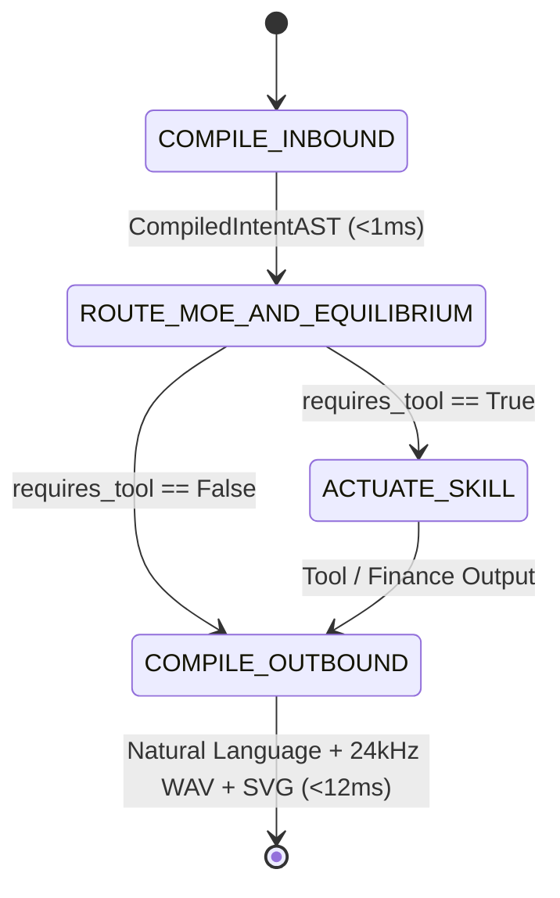

> [!IMPORTANT]
> **QUY ƯỚC BẮT BUỘC DÀNH CHO AGENT KẾ THỪA & CHỈNH SỬA TÀI LIỆU:**
> 1. **Ghi chú bắt buộc (Changelog):** Bất kỳ agent nào chỉnh sửa tài liệu này PHẢI bổ sung ghi chú tại mục Lịch Sử Thay Đổi (Tên/ID Agent, thời gian, lý do thay đổi).
> 2. **Chỉ cô lập, KHÔNG xóa bỏ:** TUYỆT ĐỐI KHÔNG xóa bỏ các nội dung/kiến trúc cũ. Toàn bộ nội dung muốn thay đổi phải được đóng khung cô lập và đánh dấu `[ISOLATED / DEPRECATED / REPLACED]`.
> 3. **Đồng bộ D:\2brain đầy đủ:** Đồng bộ và cập nhật đầy đủ mọi thay đổi, quyết định và bài học vào kho tri thức trung tâm `D:\2brain`.

# Vivyroom — 5-Pillar Architecture, Data Flow & Operational Runbook

## 1. Architecture Specification & System Map

`Vivyroom` is engineered as a single-process, zero-relay autonomous system where **`Vivy + Cautreo`** operates as one unified organism (`is_single_unified_organism = True`, `entity_count = 1`) under a strict **$\le 2,048\text{ MB}$ (`2 GB`) RAM ceiling**.

### 1.1. Proprietary 3-Cores-in-1 (`.vcore`) Container Specification
Every model artifact in `models/` uses the binary `VIVY_CORE_TRI_ENC_V1` specification:
- **Magic Header:** `b"VCORE3\x01\x00"` (8 bytes)
- **Key Derivation:** `PBKDF2-HMAC-SHA256` (`16,384` iterations) combining sovereign passphrase + hardware fingerprint salt (`b"VIVY_CORE_3IN1_SOVEREIGN_SALT_V1"`).
- **Stream Encryption & Authentication:** `SHAKE256-CTR` keystream XOR over `zlib`-compressed tensor blocks, sealed by a 32-byte `HMAC-SHA256` Encrypt-then-MAC tag.
- **RAM-Only Decryption:** `decrypt_vcore_file_to_memory()` verifies the HMAC tag before decrypting tensors directly into NumPy arrays in RAM; zero plaintext weight files are ever written to disk.

---

## 2. Functional Specifications (PRD)

1. **Ultra-Fast Natural Language Conversation (`< 15 ms`):**
   - `VivyQwenSemanticCompiler` compiles arbitrary Vietnamese/English text (including typos and missing diacritics) into a canonical `CompiledIntentAST` in `< 1 ms`.
   - `vivy_v_soul.dll` executes the 25-Step Equilibrium Thinking Loop + `vivy_nps_coupled_decide` and selects from the `6 Slots × 64 Micro-Structures` (`68.7B` combinations) in 1 step (`< 5 ms`).
2. **8-Expert Sparse MoE (`Vivy-Finance-3B-MoE`):**
   - Upcycled into 8 encrypted `.vcore` experts (`E0`..`E7`).
   - `CautreoMoEDynamicPager` pages in only the `Top-2` experts per turn and evicts inactive experts (`page_out`), keeping resident RAM around `~198 MB`.
   - If process RAM approaches `1,740 MB` (`85%` of `2,048 MB`), the Circuit Breaker automatically switches to `Top-1` mode.
3. **Autonomous Finance Desk (`0` Programmatic Filters):**
   - Evaluates `XAUUSD`, `EURUSD`, `USDJPY`, and `BTCUSD` using `vivy_core.dll` (`vivy_r_finance_analyze_json`), Quantum SVD Purity $\gamma$, Ornstein-Uhlenbeck $z_{\text{OU}}$, 50-Bot 4-Pillar Compounding $\mathcal{C}_{\text{mult}}$, and renders an inline Zero-Token SVG Candlestick/Regime chart.

---

## 3. Data Flow & State Machine (`ZeroRelayPocketGraph`)

---

## 4. Operational Runbook (SOP & Failure Handling)

- **Startup:** Run `run_vivyroom.bat` (Windows) or `./run_vivyroom.sh` (Linux/macOS).
- **Self-Test Verification:** Run `python -m vivyroom.server --self-test` to verify DLL loading, `.vcore` HMAC integrity, MoE routing, and `< 2,048 MB` RAM compliance.
- **Unattended Failure Recovery:**
  - *Malformed / Noisy User Input:* Self-healed by `VivyQwenSemanticCompiler.compile_inbound_nl_to_ast` (`0%` crash rate).
  - *Skill Execution Error:* Caught by `ZeroRelayPocketGraph`, recorded in `VM-11` Falsification Dampening (`memory_engine.py`), and gracefully reported via `COMPILE_OUTBOUND`.
  - *RAM Pressure (`>= 1,740 MB`):* `CautreoMoEDynamicPager` triggers Circuit Breaker (`top_k = 1`) or user/agent triggers `POST /api/dream` (`purge_all_expert_pages`).

---

## 5. 1-Touch Sovereign Authentication

`OneTouchSovereignAuthGate` (`vivyroom/auth_one_touch.py`) binds the `.vcore` decryption key to the local hardware fingerprint + sovereign key material (`VIVYROOM_SOVEREIGN_KEY`) and issues an HMAC-signed session ticket via `POST /api/auth/unlock` in `< 2 ms` with a single click.

---

## 6. Changelog

| Agent | Timestamp | Reason |
|:---|:---|:---|
| Antigravity IDE | 2026-10-24 11:49 ICT | Created initial 5-Pillar Architecture, Data Flow & Runbook documentation for `Vivyroom` v1.0.0. |
